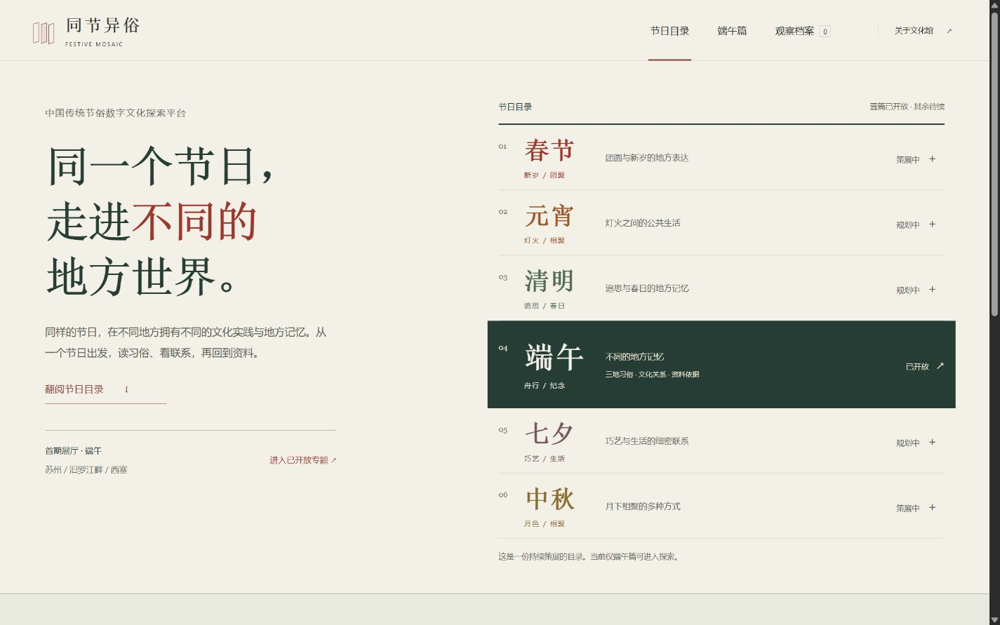

# Festive Mosaic · 同节异俗

**《同节异俗》（Festive Mosaic）——基于多源文化证据的中国传统节俗智能交互探索系统。** 这是可扩展的多节日数字文化探索平台，端午为首期已开放专题。文化前端位于 `design/prototype/`，由 VerifiAtlas D6 基线派生；下方保留原项目说明与验证记录。

- [设计审查与本轮交付](design/REVIEW_FOR_CHAT.md)
- [多节日平台架构升级：路由、配置、截图与浏览器验收](docs/PLATFORM_ARCHITECTURE_REVIEW.md)
- [2026-11-17 首页视觉重构：截图、新旧对照与验收](design/HOME_VISUAL_REVIEW.md)
- [原型启动方法](design/prototype/README.md)：在 `design/prototype` 执行 `npm.cmd run dev`，打开 <http://127.0.0.1:5175/>。新克隆先在 `frontend` 执行 `npm.cmd ci`，复用现有依赖。
- [产品概念](design/01_PRODUCT_CONCEPT.md) · [交互与视觉](design/02_INTERACTION_AND_VISUAL.md) · [内容与迁移](design/03_CONTENT_AND_MIGRATION.md) · [研究来源](design/00_RESEARCH.md)




这是明确标记 DEMO 的静态高保真原型，没有调用 DeepSeek 或接入真实文化检索。原生产前后端与 D6 结果保持不变，尚未开始正式文化系统迁移。成果推送到 [Festive-Mosaic](https://github.com/iuqllTo2048/Festive-Mosaic)。

---

# VerifiAtlas——面向科研知识探索的智能交互可视化系统

科研证据工作台。**D1–D5 的 MVP 已完成**：真实 PDF 检索、带引文问答、需求审计与一次补检，配合三维来源图、原文抽屉和执行记录回放。五题真实对照、已知限制和复核命令见 [D5 验收记录](docs/D5_VERIFICATION.md)，演示步骤见 [演示指南](docs/DEMO.md)。每阶段只提交一次，并按用户授权推送到远程仓库。

界面品牌简称 VerifiAtlas；GitHub 仓库名保留 verifyAtlas。

**D6 可靠性诊断已完成，生产代码保持 D5 基线。** 12题候选证据、9个审计对抗夹具及3组限量在线对照揭示词面召回和语义支持判断的边界；没有独立人工金标准，不把探索性指标当准确率。详见 [完整诊断](docs/D6_DIAGNOSTIC.md)、[给下一轮 Chat 的决策摘要](docs/D6_SUMMARY_FOR_CHAT.md) 和 [原始结果](eval/d6_results.jsonl)。D7只作建议，尚未实施。

## 当前能力

- 上传文本型 PDF，按实际页面解析、分块（800 字符、100 字符重叠），保留稳定文档/片段 ID、页码和字符范围。
- SQLite 持久化，原 PDF 保存在本机；SHA256 去重，重启后数据保留。
- 语料列表、逐页原文检查、片段分页、打开 PDF 对应页。
- 顶栏可切换浅色/深色主题，首次打开跟随系统；手动选择保存在当前浏览器，刷新后保留。禁用本地存储时仍可切换，但无法跨刷新保存。
- 3 篇官方论文来源清单，可分别一键导入；下载失败会报告原因并提供官方页面及手动上传入口。
- 空文件、错误格式、损坏 PDF、加密文件、过大文件和无可提取文本文件有明确错误。混合文档中没有文本的页面保留实际页码并显示警告；页面解析异常时整份导入失败。
- 基于已导入片段的 BM25Plus 词面检索；可以检索全部语料或当前论文，每次最多 8 个片段。
- DeepSeek 结构化回答，每段必须有本轮检索片段中的有效原文引句；引用的文档、页码、片段 ID 和 PDF 地址由后端确定。不能核对的段落被移除，无证据时明确报告不足。
- 点击回答中的引用定位到完整原文片段；问答及引用映射保存到本机 SQLite，提供稳定的 run ID。
- 问答成功后 URL 带有 `?run=<ID>`，刷新可恢复该记录，不重复请求 LLM；记录仅在这台机器的本地服务中有效。
- 审计模式拆解 1–4 个证据需求；只有模型提出直接支持、回答有效且引句能在本轮片段中定位时，才计为“有引用支持”。回答中的拉丁术语和数字还需出现在实际引句中，审计解释中的术语和数字需在所引用完整片段中出现；裁剪未要求的释义任务。失败候选保留为审计记录，不产生支持边。新记录标记 `quoted_claims_v2`，旧记录提示重新核查。
- 对不足需求最多执行一轮定向补检，之后明确停止；请求次数和模型调用共享时间预算，失败时保留已经核对的证据。
- 论文 / 片段 / 术语 / 需求的真实来源关系与 trace 保存在本机。术语由原文规则提取并记录字符位置，每个片段最多 3 个术语，每次检索最多扩展 2 个片段；共现只表示检索关联，不是语义事实。

- 三栏研究工作台；三维图仅显示 API 返回的论文、片段、术语与需求。点击需求聚焦来源链，证据不足保持缺口，点击论文/片段打开真实原文抽屉。
- 完成后的真实 trace 可逐步或自动回放；当前事件之前的支持状态、最终答案和引用不会提前呈现。系统启用减少动态效果时改为手动逐步操作。
- 3D 可切换为同一批节点和关系的等价列表，窄屏默认使用列表；明暗主题覆盖界面与图谱。

模型支持判断加上引文存在性检查，仍不证明科学事实；请核对上下文。没有向量模型和完整语义知识图谱；审计模式可用规划/补检的英文关键词辅助检索，基本 BM25 模式仍依赖词面匹配。五题对照是小样本探索，独立需求规划与模型输出可能变化，不能视作准确率或补检因果效果的证明。

## 环境与首次安装（Windows PowerShell）

需要 Python **3.12**、[uv](https://docs.astral.sh/uv/getting-started/installation/) 和 Node.js **22.12+**（当前验证为 22.23.2；Node 24 LTS 也可）。项目不要求全局安装前端构建工具，也不需要激活虚拟环境。

```powershell
Set-Location E:\VerifiAtlas\backend
uv sync --locked --python 3.12

Set-Location E:\VerifiAtlas\frontend
npm.cmd ci --no-audit --no-fund
```

后端依赖锁定在 `backend/uv.lock`，前端依赖锁定在 `frontend/package-lock.json`。前端项目级 `.npmrc` 使用官方 npm 源，避免镜像版本不同步；不修改系统 npm 设置。

## 启动（两个 PowerShell 窗口）

窗口 1：

```powershell
Set-Location E:\VerifiAtlas\backend
uv run --locked uvicorn app.main:app --host 127.0.0.1 --port 8000
```

窗口 2：

```powershell
Set-Location E:\VerifiAtlas\frontend
npm.cmd run dev
```

打开 [本地工作台](http://127.0.0.1:5173/)。健康检查为 [GET /api/health](http://127.0.0.1:8000/api/health)，交互 API 文档为 [OpenAPI /docs](http://127.0.0.1:8000/docs)。两个窗口按 `Ctrl+C` 停止。

前端通过 Vite 代理访问后端，不需要配置 CORS。默认仅监听本机环回地址；本项目当前没有登录或访问控制，不用于公开网络。请只启动一个后端进程，勿使用多个 worker。

## 最短人工验收

1. 展开左侧“导入官方论文”并点击“导入”；也可以点击“上传论文”选择 PDF。窄屏先点击顶栏“语料”。
2. 左侧选择文档，在原文抽屉切换“实际页码”，检查该页原文片段，再点“打开 PDF 对应页”与实际 PDF 页面核对。这里的页码是 PDF 页面序号，不是论文印刷页码。
3. 再次上传同一 PDF，应提示文档已存在，文档数量保持不变。
4. 上传空文件、改名为 `.pdf` 的其他格式、损坏文件或没有可提取文本的文件，确认提示清楚且没有假成功记录。
5. 选择 KG²RAG 并勾选“仅检索当前选中的论文”，输入 `Which benchmark dataset and its variants were used to evaluate KG2RAG? Answer only from the paper and give source quotes.`。回答应能找到 HotpotQA 的来源；点击引用，核对片段和实际页码。某一名称若未检索到，不应补写成已知事实。
6. 展开问题框下的检索设置，启用需求审计和一次补检，对 KG²RAG 问：`Which evaluation dataset does KG2RAG use, and what measured energy consumption in joules per query does the paper report? Cite evidence for each; if a measurement is not supported by the excerpts, say it is unknown.`。数据集可引用，不能用响应时延冒充能耗；观察能耗缺口补检一次后停止。
7. 点击右侧需求聚焦来源链；点击图中论文/片段或引用打开原文。拖动旋转、滚轮缩放，用“重置视角”恢复全图；切换“列表”可通过键盘操作所有节点与关系出处。`Esc` 关闭原文/抽屉或清除聚焦；`Tab` / `Enter` 操作按钮，聚焦回放滑杆后用方向键、`Home` / `End` 定位事件。
8. 用底部执行回放检查规划、检索、审计与停止事件，按“回到结果”恢复最终图。回放是完成后的记录，展示间隔不是模型耗时。窄屏通过“审计与来源”打开审计栏。

图中距离与固定分区仅用于阅读，不表示科学相似度、因果或证据强度。最多显示 120 个节点，裁剪时有提示；图谱依赖按需加载，WebGL 初始化失败时使用列表。后端健康接口仍标记 D3 能力，D4 未改变 API。

上传只发送给本机后端。浏览器 PDF 阅读器通常支持 `#page=N`；若阅读器未自动定位，请手动输入该页码。文字提取可能受到字体编码、分栏和数学公式影响，原 PDF 始终是核对依据。

## 配置与本地数据

默认可直接运行。需要调整限制时，将 `backend/.env.example` 复制为 `backend/.env`：

```powershell
Set-Location E:\VerifiAtlas\backend
Copy-Item .env.example .env
```

D2 的问答需要 `DEEPSEEK_API_KEY`。已有同名环境变量时直接读取，无需复制密钥到文件；环境变量优先于 `.env`。若尚未配置，可自行在本机 `backend/.env` 中填写，勿将真实密钥发到聊天、提交 Git 或放入前端。配置改变后重启后端；健康检查的 `llm_configured` 只说明是否配置，不证明密钥、额度或网络可用。

点击“开始检索”会把问题与每轮至多 8 个片段发送到配置的 DeepSeek 服务，消耗账户 API 调用额度；原始 PDF 不会整份上传。基础模式空检索不请求 LLM；审计模式即使缺少匹配片段，也可能先调用模型规划需求，并针对缺口补检。后端不记录密钥或上游错误原文；每个结构化步骤失败最多重新请求一次，所有重试都计入整轮请求预算。网络、鉴权和服务错误不自动重试。问答、审计、图和轨迹都保存到被 Git 忽略的本地数据目录。

| 设置 | 默认值 | 说明 |
| --- | --- | --- |
| `DATA_DIR` | `./data` | 相对路径固定相对于 `backend/`，不受启动目录影响 |
| `MAX_UPLOAD_MB` | `20` | PDF 文件大小上限 |
| `MAX_PDF_PAGES` | `200` | 实际页数上限 |
| `SEED_TIMEOUT_SECONDS` | `30` | 官方来源连接与读取超时 |
| `DEEPSEEK_API_KEY` | 空 | 后端私密配置；已有环境变量可直接使用 |
| `DEEPSEEK_BASE_URL` | `https://api.deepseek.com` | OpenAI 兼容接口地址 |
| `DEEPSEEK_MODEL` | `deepseek-flash` | 可按账户可用模型覆盖 |
| `LLM_TIMEOUT_SECONDS` | `40` | 每次模型请求超时，上限 50 秒 |
| `LLM_MAX_TOKENS` | `1800` | 单次输出 token 上限 |
| `AGENT_MAX_REQUESTS` | `6` | 一轮审计最多模型请求数（含格式重试），可设置 1–6 |
| `AGENT_TIMEOUT_SECONDS` | `100` | 模型调用共享截止预算，每次请求还受单次超时约束 |

SQLite 在 `E:\VerifiAtlas\backend\data\evidence.sqlite3`，原 PDF 在 `E:\VerifiAtlas\backend\data\pdfs\`。文件名由服务端 SHA256 生成，上传文件名不能决定磁盘路径。导入失败会撤回数据库事务并清理对应临时文件。启动失败时检查数据目录是否可写以及 8000/5173 端口是否被占用。

`backend/data/`、虚拟环境、`node_modules/`、构建产物和 `.env` 均不纳入 Git。不要提交真实密钥或用户 PDF。官方来源下载记录原始 PDF URL、来源页面和 UTC 获取时间；普通手动上传保留原文件名和导入时间，不推测作者、年份或来源 URL。

## API 与协议生成

Pydantic / FastAPI OpenAPI 是协议源。前端 `src/api/schema.ts` 由导出的 OpenAPI 自动生成，勿手工修改。

| 接口 | 说明 |
| --- | --- |
| `GET /api/health` | 健康状态、阶段与上传限制 |
| `GET /api/documents` | 已成功导入的文档（有警告时含警告详情） |
| `POST /api/documents/upload` | multipart 字段 `file`；返回文档和 `duplicate` |
| `GET /api/documents/{id}/chunks` | 可选 `page`、`offset`、`limit`；上限 100，按稳定顺序返回 |
| `GET /api/documents/{id}/pdf` | 从数据库已登记文档安全读取原 PDF |
| `GET /api/papers` | 仅返回官方来源元数据，不代表已导入 |
| `POST /api/documents/seed` | JSON `{"paper_ids":["kg2rag"]}`，可选 `kg2rag` / `lightrag` / `paperqa2` |
| `POST /api/query` | JSON `{"question":"...","document_ids":null,"top_k":6,"mode":"audited","enable_repair":true,"enable_graph_expansion":true}`；返回回答、引用、需求、审计、graph、trace 和统计 |
| `GET /api/chunks/{chunk_id}` | 查询引用的完整原文片段，用于精确定位 |
| `GET /api/runs/{run_id}` | 读取已保存的问答及 citation → document/chunk/page/quote 映射 |

单个上传错误以非 2xx 状态和 `{"error":{"code":"...","message":"..."}}` 返回。种子导入支持逐项成功或失败，因此 HTTP 200 仍需检查每项 `status` 和 `error`；失败项不生成文档。

`/api/query` 的 API 默认 `mode="basic"`，保持 D2 调用兼容；当前网页默认勾选审计模式。可设置 `enable_repair=false` 比较关闭补检的行为，或 `enable_graph_expansion=false` 只保留来源图。审计阶段上游出错时可能返回 HTTP 200 的部分结果，需查看 `insufficient`、`stats.stop_reason` 与 `trace`；部分已有支持证据不会因后续错误丢失。旧 D2 记录读取时保持基础模式，新增字段按空值/默认值补全，不伪造历史审计。

图边只有 `contains`（上传来源）、`mentions`（原文术语位置）和 `supports`（模型提出支持且引句匹配）。所有边附 provenance，可回到文档、页码、片段和审计 ID。覆盖计数只按最终 Requirement 状态计算，不代表事实正确率。图最多取本轮两次检索的片段，没有随机节点。关闭或失败的概念扩展会明确标注降级。

修改协议后：

```powershell
Set-Location E:\VerifiAtlas\backend
uv run --locked python -m app.export_openapi
Set-Location E:\VerifiAtlas\frontend
npm.cmd run generate:api
```

## 验证

先运行最小相关测试，再执行完整检查：

```powershell
Set-Location E:\VerifiAtlas\backend
uv run --locked pytest tests/test_ingest.py -k "ingest_pages or duplicate_upload"
uv run --locked pytest

Set-Location E:\VerifiAtlas\frontend
npm.cmd run typecheck
npm.cmd test
npm.cmd run build
```

真实语料检查（需后端运行，会将官方论文下载到本机）：

```powershell
Set-Location E:\VerifiAtlas\backend
uv run --locked python scripts/verify_d1_live.py --import-seeds
```

脚本检查原 PDF SHA256、实际页数、每个片段的页码/字符范围和真实 PDF 重传去重；不调用 LLM，不把论文原文写入验证报告。结果默认保存到 `E:\VerifiAtlas\artifacts\d1\live-check.json`。不加 `--import-seeds` 可仅核对当前已导入文档。

真实问答 smoke test（后端运行、已导入官方 KG²RAG，默认会实际请求 DeepSeek）：

```powershell
Set-Location E:\VerifiAtlas\backend
uv run --locked python scripts/verify_d2_live.py
```

结果保存到 `E:\VerifiAtlas\artifacts\d2\live-check.json`。已有浏览器问答 run ID 时，可加 `--run-id <ID>` 复核记录，不再次调用 LLM。

真实 D3 审计与补检检查（需后端运行、已导入官方 KG²RAG，会实际调用 DeepSeek）：

```powershell
Set-Location E:\VerifiAtlas\backend
uv run --locked python scripts/verify_d3_live.py
```

报告为 `E:\VerifiAtlas\artifacts\d3\live-check.json`，检查一次真实补检、未解决需求、图边出处、引文、覆盖计数、trace 引用与持久化。加 `--run-id <ID>` 可复核已有记录，不再次调用模型。

实际验证记录见 [D1](docs/D1_VERIFICATION.md)、[D2](docs/D2_VERIFICATION.md)、[D3](docs/D3_VERIFICATION.md)、[D4](docs/D4_VERIFICATION.md)、[D5](docs/D5_VERIFICATION.md)。自动测试里的合成 PDF、LLM Stub 和 HTTP Mock 仅用于测试；不使用真实密钥，不调用付费接口。标注问题及实际观察见 [evaluation_questions.md](samples/evaluation_questions.md)；D5 的五题输入为 [d5_questions.json](samples/d5_questions.json)。截图与报告保存在 `E:\VerifiAtlas\artifacts\d5\`；对比度见 `artifacts/d4/contrast-check.json`，构建产物为 `E:\VerifiAtlas\frontend\dist\`。

复核已保存的 D5 对比（只 GET 来源与记录，不调用模型，需同一份本地数据库）：

```powershell
Set-Location E:\VerifiAtlas\backend
uv run --locked python scripts/evaluate_d5.py
```

新机器要重新执行五题对比，需先导入官方 KG2RAG、LightRAG 和 PaperQA2，再使用新的输出目录明确请求执行：`uv run --locked python scripts/evaluate_d5.py --execute --output ../artifacts/d5-new`。此命令会实际发送问题和公开论文片段到 DeepSeek；已有缓存不自动重跑、失败不自动重试。默认目录保留本次观察证据，请勿用新结果覆盖历史报告。

没有 key 的界面验收可使用隔离工具（先构建前端）：`uv run --locked python scripts/serve_d5_no_key.py`，然后打开 `http://127.0.0.1:8001/`。它强制空 key、忽略 `.env`、仅监听本机，数据写入被 Git 忽略的 `backend/data/d5-no-key/`，不改变正常服务的 key 或语料；按 Ctrl+C 停止。不要将此验收工具作为正式服务入口。

3D 使用 `3d-force-graph`、Three.js 和 `three-spritetext`，许可证及归属见 [THIRD_PARTY_NOTICES.md](THIRD_PARTY_NOTICES.md)。主界面脚本约 112 kB；三维依赖为按需加载的大块，构建仍会报告 500 kB 提示，不表示构建失败。

## 论文与技术来源

元数据清单为 [samples/papers.json](samples/papers.json)，本地导入不代表获得 PDF 再分发许可，仓库不包含论文原文件。

- [KG²RAG，NAACL 2025 官方页面](https://aclanthology.org/2025.naacl-long.449/)
- [LightRAG，arXiv v3](https://arxiv.org/abs/2410.05779v3)（2024 年首发，2025 年修订）
- [PaperQA2，arXiv v2](https://arxiv.org/abs/2409.13740v2)
- [Vue](https://vuejs.org/)、[Vite](https://vite.dev/)、[FastAPI](https://fastapi.tiangolo.com/)、[pypdf](https://pypdf.readthedocs.io/)

当前只导入这些论文作为可核对语料，没有集成或复现 KG²RAG、LightRAG 或 PaperQA2 的算法实现。
