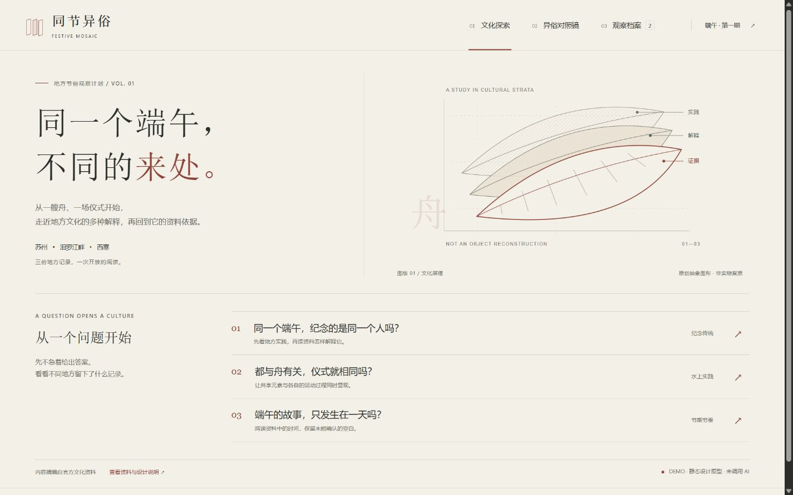
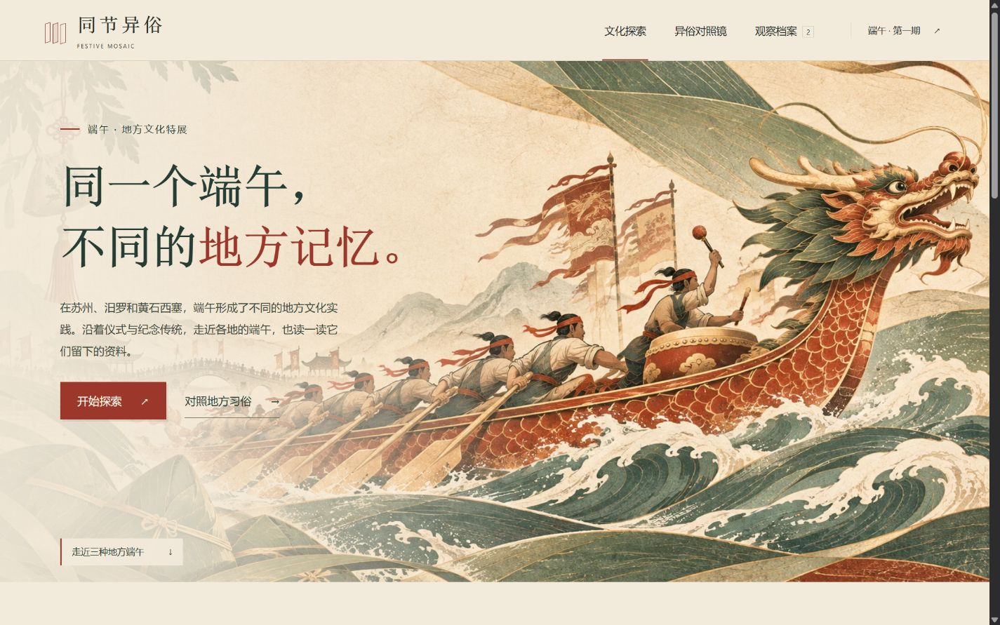

# Festive Mosaic｜首页视觉重构验收

日期：2026-11-17，Asia/Shanghai。阶段：**首页视觉重构与艺术资产集成，已完成本轮实现和浏览器检查，等待用户艺术方向审核。** 基线提交：`3afa709a3e4e080be82dffb6f04ade7e1d4f7285`；分支：`design/cultural-exploration`；推送目标为 Festive-Mosaic，非原 VerifiAtlas 仓库。

## 构图与视觉调整

艺术语言为 **Contemporary Chinese Printmaking × Cultural Exhibition × Editorial Web Design**。

首屏移除抽象曲线图版，以用户提供的龙舟竞渡作为完整构图的艺术主体。画面只覆盖Hero，不是整页固定背景；保留右侧龙首、朱红船体和下方水纹，左侧用局部纸色过渡建立标题阅读区域。标题改为“同一个端午，不同的地方记忆。”，配合介绍苏州、汨罗及黄石西塞的具体文字，以及“开始探索”“对照地方习俗”两个操作。桌面Hero高750px，1024宽时高650px；没有圆角图片卡片。

第二屏以拼贴图的右侧局部为一幅纵向专题图版，对应另一侧的三地资料目录。目录有不同名称、引导语、内容摘要与来源编号，不制作三张重复的图片区卡。现有内容沿用此前查阅的地方资料；不从艺术画面编造新的地方习俗。主题条目预留可选image字段，后续可接入三张专属插画，本轮没有生成或替代这些插画。

第三屏使用已有层理工作台、异俗对照界面的真实截图作为预览；来源入口直接打开现有S01说法剖面。保留三个问题入口，仍可分别进入纪念传统、水上实践、节期节奏。首页不初始化Three.js场景，没有伪造执行数据。

纸色采用#F2EADB，主文字深青绿#253D34，强调朱砂红#9C382B；正文使用系统无衬线，主题标题使用Songti SC/SimSun/serif。导航从原来的小号编号模式调整为更清楚的文字入口。首页正文14–16px、操作14–16px，减少辅助英文；中文内容优先。探索和对照维持原有阅读布局，未改为图片背景。

手机独立采用文字与操作在上、295px高艺术画面在下的构图，图像以右侧取景呈现。专题拼贴改为240px高横向局部，目录、预览和来源阅读改为纵向排列。滚动揭示与Hover只在 `prefers-reduced-motion: no-preference` 下启用，没有自动旋转或持续粒子动画。

## 实际使用的资产

| 资产 | 来源 | 实际路径与用途 |
| --- | --- | --- |
| hero_dragon_boat.webp | 用户提供的FestiveMosaic_VisualKit | `design/prototype/public/images/hero_dragon_boat.webp`，首屏；1672×941，471,504字节 |
| cultural_collage.webp | 同上 | `design/prototype/public/images/cultural_collage.webp`，第二屏；1672×941，333,128字节 |
| cultural-strata.jpg | 上阶段实际界面截图02 | `design/prototype/public/previews/`，层理入口预览 |
| comparison-lens.jpg | 上阶段实际界面截图03 | 同上，双主题对照预览 |

两张WebP为原文件直接复制，SHA256及原尺寸记录见 [资产清单](prototype/public/images/README.md)。不拉伸、不重绘、不调用在线图库，没有把整张图片当作UI。静态路径由 `import.meta.env.BASE_URL` 计算，当前开发地址为 `/images/…`，兼容相对路径构建。

## 修改文件与原因

| 文件 | 原因 |
| --- | --- |
| `prototype/src/HomeExhibition.vue` | 独立TypeScript首页组件，三屏内容与现有入口事件 |
| `prototype/src/home.css` | 版画Hero、专题目录、交互预览、手机取景及减少动态效果规则 |
| `prototype/src/App.vue` | 用新组件替换旧首页；连接现有探索/主题/对照/来源函数；首页导航样式；更新作品说明文字 |
| `prototype/src/HeroArt.vue` | 删除不再使用的旧曲线图版 |
| `prototype/src/main.js`、`prototype/index.html` | 载入首页样式、更新主题色与页面描述 |
| `prototype/package.json`、`tsconfig.json`、`src/home-env.d.ts` | 为新增TypeScript首页提供独立类型检查，不增加依赖 |
| `prototype/public/images/`、`public/previews/` | 本轮实际使用的本地资源 |
| `scripts/assemble-home-capture.ps1`、`screenshots/home-art/` | 浏览器原始截图、滚动位置及可复现的长图组合 |
| 根README、原型README、设计规范及本报告 | 新首页入口、命令、视觉规范和真实验收结果 |

后端、原生产前端、文化数据、图谱算法和D6诊断文件无修改。没有接入新业务或后端服务，没有安装新依赖。用户源素材目录和ZIP未暂存。

## 浏览器实际验收

环境：Windows、Node22.23.2、Vue3.5.45、Three0.187.0、Vite8.3.8；ChatGPT内置浏览器。检查方式为真实点击/选择/滚动、DOM读取与截图逐屏审阅；用户最终艺术审核待进行。

| 检查 | 实际观察 |
| --- | --- |
| 1440×900 | 标题与龙首形成左右焦点；船体与水纹保留；首屏操作可见；全页无横向溢出 |
| 1024×768 | 50px标题、650px Hero；龙首在右侧，正文与操作均可读；无横向溢出 |
| 390×844 | 标题约35.88px，正文14px；双操作在艺术画面上方；整个Hero约704px；无横向溢出 |
| 资源加载 | 两张WebP与两张界面预览均加载成功，DOM自然尺寸匹配；最终重载破图数0 |
| 开始探索 | 进入水上与生活实践维度，手机同源列表包含4条摘编关系 |
| 三个地方入口 | 苏州显示2条、汨罗显示1条、西塞显示1条当前实践关系，均进入原有工作台 |
| 对照地方习俗 | 苏州/汨罗实践对照显示共同记录1项，S01/S02保持匹配 |
| 文化资料溯源 | 直接打开苏州竞渡的剖面，定位摘录及官方链接匹配S01；Escape可关闭返回 |
| 问题与预览入口 | 节期问题显示2条现有记录；层理预览进入纪念传统问题；原有导航与观察档案入口保留 |
| 减少动态效果 | 最终浏览器 `prefers-reduced-motion: reduce=true`；动态规则被媒体查询约束；未强制模拟另一系统设置 |
| 最终浏览器错误 | 重载后的warn/error为0；开发中有一次模板引号错误造成HMR失败，已修正并重新构建，未把历史错误隐去 |

### 新旧效果对照

两图均在1440×900视口下实际采集。旧版是修改前本轮新拍的基线。

| 重构前 | 重构后 |
| --- | --- |
|  |  |

新版以文化艺术主体、明确内容和操作入口替换原抽象剖面与大面积留白；来源和交互说明分配到后续屏幕，避免辅助标签占据首屏。

### 截图清单与长图方法

- [1440首屏](screenshots/home-art/after-1440-hero.jpg)
- [首页完整滚动拼接图](screenshots/home-art/after-1440-full.jpg)
- [第二屏文化专题](screenshots/home-art/after-1440-topics.jpg)
- [第三屏交互预览](screenshots/home-art/after-1440-interactions.jpg)
- [1024首屏](screenshots/home-art/after-1024-hero.jpg)
- [390手机首屏](screenshots/home-art/after-390-hero.jpg)

浏览器的fullPage截图接口失败；扩大截图视口后仍只输出部分高度，未把该截断结果作为全页交付。最终用原1440×900视口依次在scrollY=0、900、1800、1998采集四张原始图，页面CSS高度2898。按实际滚动位置只取一次重叠区域，组合成1425×2869的完整图，覆盖到页尾；浏览器工具会缩放截图输出，因此文件像素与CSS视口不完全相同。四张原图与 [位置记录](screenshots/home-art/scroll-positions.json) 均保留。脚本只组合浏览器捕获内容，没有重绘页面或改动美术资产。

## 运行与测试结果

在 `E:\VerifiAtlas\design\prototype` 实际执行：

| 命令 | 结果 |
| --- | --- |
| `npm.cmd run dev` | 5175端口启动成功，实际浏览器检查完成；验收后停止本轮服务 |
| `npm.cmd test` | 4通过、0失败、0跳过；沿用文化数据和关系结构测试 |
| `npm.cmd run typecheck` | 通过，检查新增首页TypeScript组件及其导入类型；不宣称对原JavaScript工作台完成了全量严格类型检查 |
| `npm.cmd run build` | 成功，20模块；CSS约39.89kB，首页JS约107.83kB；原三维延迟块约572.55kB |
| `design/scripts/assemble-home-capture.ps1` | 实际成功，完整滚动图1425×2869 |

构建保留原Three.js分块大于500kB的告警，没有调高阈值掩盖。没有重跑未改动后端的完整测试，也没有修改业务判断来取得通过。构建输出在 `E:\VerifiAtlas\design\prototype\dist`，Git忽略。

## 尚未解决的视觉问题与停止点

1. 苏州、汨罗、西塞专属插画尚未提供；目前通过专题拼贴和编辑式目录建立第二屏，已留插画字段，不在本阶段自行生成。
2. 第三屏的截图用于识别交互形态，小字不适合直接阅读；点击进入实际工作台后阅读。后续可根据用户艺术审核决定是否制作更聚焦的交互局部预览。
3. 手机采用局部取景，会舍去龙舟尾部和部分左侧景物；这是当前取舍，等待用户依据手机截图确认。不同系统宋体字形、实体手机显示与触控尚未逐机测试。
4. 没有模拟所有动效设置、慢网和不同GPU，本轮也不优化或重做三维工作台。

**本阶段结束，等待用户依据截图确认艺术方向，以及是否提供/生成三地专属插画。没有继续重做其他页面。**
