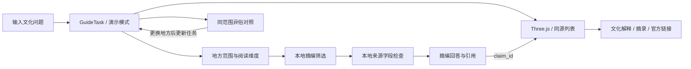

# Festive Mosaic｜艺术素材、文化导览与图谱联动

日期：2026-11-17。起始提交：`0fc124783ef934c56bbb8f07d0bd545de4c0079b`。文化前端位于`E:\VerifiAtlas\design\prototype`，推送目标为`festive-mosaic`（Festive-Mosaic）的main及现有文化分支。原科研远程origin不推送。

本阶段定位：**《同节异俗》——融合AI Agent、RAG、知识图谱和交互可视化的中国传统节俗文化探索平台。** 当前完成艺术资产集成与可操作的前端导览演示，真实文化Agent/RAG后端尚未接入。端午仍是唯一开放专题。

## 能力与运行方式

| 能力 | 本轮实际状态 | 边界 |
| --- | --- | --- |
| 多节日艺术门户、六篇目录 | 真实Vue组件；双入口进入导览/知识图谱 | 五个其他节日仅筹备说明 |
| 问题输入、地方范围与阅读维度规划 | 可操作的本地规则 | 没有LLM任务规划 |
| 资料检索 | 按地方、关键词和维度筛选既有摘编 | 明确为演示；没有在线RAG、Embedding或联网抓取 |
| 导览回答 | 将匹配的实践→解释关系整理为短摘编，附可点击引用 | 没有生成式回答；不是开放域问答 |
| 来源检查 | 实际检查本地来源ID、HTTPS链接、非空摘录和located字段 | 没有验证网页当前内容、引句蕴含或历史结论 |
| 语义核验与人工认证 | 未执行 | 不生成模型支持或人工认证记录 |
| Three.js、列表、引用聚焦、来源抽屉 | 真实运行，复用同一批claim/source ID | 图谱表示摘编与目录关系，不认证传承 |
| 对照与任务同步 | 真实运行；问题、地方范围、引用与对照相连 | 只在当前页面会话保留导览任务 |
| 观察档案 | 既有本地保存继续可用 | 无账号、云同步或正式导出 |

代码检查未发现文化前端调用fetch、axios或文化Agent接口；仓库已有`backend/app/main.py`的`/api/query`等接口属于科研论文流程，协议是论文、Chunk、需求审计和引用。本轮没有调用、修改或包装它们来冒充文化后端，也没有读取或输出密钥。

界面常驻“演示模式 · 未连接模型”，执行记录中的RAG阶段明确写为本地摘编筛选。耗时由performance.now实际计量，模型调用量固定为真实的0；不模拟网络等待、Token量或虚构逐步执行动画。

## 素材核对与视觉安排

已阅读用户解包到根目录的`ASSET_MANIFEST.md`，结合`FestiveMosaic_Images_Repacked/README.md`与contact sheet确认实际文件。优先使用用户后来指定的`FestiveMosaic_Images_Repacked/assets`版本，不使用根目录另一个assets副本。

六张WebP原样复制到`design/prototype/public/images/art/`，逐字节比对通过，总约3.41MB。哈希、字节数与职责见[资源清单](../design/prototype/public/images/art/README.md)。

| 素材 | 实际使用 |
| --- | --- |
| portal_festival_hero.webp | 平台首屏多节日主视觉，标题与双操作为独立Vue元素 |
| feature_ai_guide.webp | 门户导览模块与工作台小面积配图 |
| feature_comparison.webp | 门户对照入口与对照主题选择区 |
| feature_source_trace.webp | 门户来源入口与资料抽屉顶部配图 |
| duanwu_dragon_boat.webp | 端午专题主视觉，沿用原三屏结构 |
| duanwu_collage.webp | 端午地方文化目录辅助视觉 |

`portal_ui_concept_REFERENCE_ONLY.png`仅查看构图参考，没有进入静态目录、CSS背景、页面截图拼片或按钮素材。没有下载外部图片、新增依赖或生成新插画。

门户首屏左侧是多节日艺术与平台主张，右侧保留清晰目录；“AI文化导览”和“探索文化知识图谱”直接可进入。下方三种阅读方式配艺术局部和真实操作，避免把插画当交互。工作台中图谱占主要面积，导览在侧边，资料抽屉采用档案式排版。1024保留图谱/导览双栏，地方目录上移；390将导览与同源列表顺次排列。

浏览器视觉检查后加强首屏文字区的纸色遮罩，手机改为下方300px独立艺术取景，保留灯笼、月色、柳枝与舟等多节日线索。未把桌面横图直接拉伸到竖屏。动效沿用prefers-reduced-motion处理，图谱不空闲旋转。

## 共享任务、图谱与来源

`GuideTask`包含question、festival_id、topic_ids、dimension、status、steps、evidence、answer、gaps、model_calls、semantic_review、elapsed_ms。引用保留claim_id与source_id，直接沿用原文化数据身份。App保存这份任务；图谱范围、回答引用、资料抽屉和对照选择使用同一组地方与关系。切换对照地方时重新执行本地筛选并更新问题，返回导览后输入与图谱范围保持一致。

回答引用会切换到该claim所属的阅读维度并聚焦关系；“查看关联资料”打开同一claim的抽屉。三维节点、实际连线和列表条目均可进入对应资料。节点聚焦还可通过三维层次按钮与复位控制；不依赖背景图。

| 节点/关系 | 数据含义 |
| --- | --- |
| festival / topic | 端午与地方文化主题，来自已发布目录配置 |
| practice / interpretation / source | 仪式或生活实践、摘编解释、资料来源 |
| shared / uncertain | 已摘编共同元素、无充分依据的候选问题 |
| festival_topic / topic_practice | 目录归属、习俗包含，不能解释为历史传承 |
| interpretation / source | 原摘编解释链、来源指向；仍待独立审读 |
| comparison / uncertain | 共享feature的对照、资料不足的候选联系 |

目录节点/归属连线点击聚焦地方范围，内容关系点击打开对应资料；目录归属本身不伪造支持引句。候选问题打开证据缺口，不提供虚假支持来源。新增边携带not_reviewed或insufficient状态。原摘编及feature交集保持不变，没有将术语共现升级为文化传承。

二维列表按相同的claim ID呈现内容关系，顶部保留节日/地方范围；并非把16个不同类型节点机械复制成16行。来源、解释和目录归属仍可在同一上下文读取。

## 必须流程的实际结果

从平台进入端午篇，点击AI文化导览，输入并提交：**“苏州和汨罗的端午习俗有什么不同？”**

1. 本地识别苏州、汨罗，实践维度为主，同时取纪念摘编；实际候选与保留均为5条。
2. 结果分别列出苏州的竞渡、香包、伍子胥纪念，及汨罗的赛龙舟、屈原纪念，并显示两地共同竞渡的摘编。
3. 图谱范围收敛为两地；实践视图12节点、13连线，含节日、地方、活动、解释、来源与候选问题。
4. 点击回答中的S01地方纪念引用，实际切到纪念维度，图谱9节点、8连线，聚焦sz-memory；抽屉显示“纪念伍子胥”与S01官方链接。
5. 实际点击Three.js龙舟竞渡节点，打开sz-race/S01；实际点击汨罗实践→解释连线，打开ml-race/S02。
6. 从导览进入对照，保留问题、苏州/汨罗及实践维度，显示共同竞渡1项；B改为西塞后，任务、返回导览的输入与图谱范围同步为苏州/西塞。

首次细连线点击未命中，检查后将命中容差从3扩大到8世界单位，复测成功；没有将首次未命中标成通过。目录归属属于结构性关系，操作语义见上表。

手机实操还验证：默认同源列表、列表→S01抽屉、未开放中秋问题→资料不足及0条结果、筹备专题仍只显示状态说明。单元夹具另外验证来源字段失效会触发validation_failed并移除答案；没有破坏生产资料来制造这个状态。

资料原文链接身份保持为S01 `https://szfy.wglj.suzhou.com.cn/fy-project/16`与S02 `https://www.ihchina.cn/project_details/14916.html`。本轮检查链接、摘录与claim的联动，不重做文化史实的独立人工审读。

## 截图与浏览器验收

使用真实in-app Chromium浏览器与HTTP服务，实际innerWidth/innerHeight分别为1440×900、1024×768、390×844；门户、端午专题和导览工作台均无横向溢出。截图已逐张视觉复核；这是Codex检查，用户艺术审核和真人可用性测试待进行。

| 内容 | 交付截图 |
| --- | --- |
| 平台首页 | [1440](../design/screenshots/agent-graph/portal-1440.jpg)、[1024](../design/screenshots/agent-graph/portal-1024.jpg)、[390](../design/screenshots/agent-graph/portal-390.jpg) |
| 三张功能插画与入口 | [门户功能区](../design/screenshots/agent-graph/portal-features-1440.jpg) |
| 端午专题 | [1440](../design/screenshots/agent-graph/duanwu-1440.jpg)、[1024](../design/screenshots/agent-graph/duanwu-1024.jpg)、[390](../design/screenshots/agent-graph/duanwu-390.jpg) |
| AI导览工作台 | [1440](../design/screenshots/agent-graph/agent-workspace-1440.jpg)、[1024](../design/screenshots/agent-graph/agent-workspace-1024.jpg)、[390](../design/screenshots/agent-graph/agent-workspace-390.jpg) |
| 执行步骤与图谱 | [执行记录](../design/screenshots/agent-graph/agent-execution-1440.jpg)、[Three.js](../design/screenshots/agent-graph/threejs-graph-1440.jpg) |
| 引用与实际点击联动 | [回答→图谱](../design/screenshots/agent-graph/answer-graph-focus.jpg)、[节点→来源](../design/screenshots/agent-graph/node-source-link.jpg)、[连线→来源](../design/screenshots/agent-graph/edge-source-link.jpg) |
| 同任务对照 | [对照工作台](../design/screenshots/agent-graph/comparison-task-1440.jpg) |
| 手机阅读与缺口 | [同源列表](../design/screenshots/agent-graph/graph-list-390.jpg)、[资料抽屉](../design/screenshots/agent-graph/source-390.jpg)、[资料不足](../design/screenshots/agent-graph/insufficient-390.jpg) |

浏览器工具输出像素略小于CSS视口（例如1440导出1425×891）；尺寸验收以实际DOM视口为准。原始浏览器观察与控制台记录见[browser-checks.json](../design/screenshots/agent-graph/browser-checks.json)，其中保留开发过程的早期布局观察及后续修正；不混计为单元测试数量。

## 工程结果与修改文件

Windows PowerShell、Node22.23.2、现有Vue3/TypeScript/Three.js/Vite8.3.8；无安装或大规模迁移。在`E:\VerifiAtlas\design\prototype`实际运行：

- `npm.cmd test`：12通过、0失败、0跳过。原8项+导览4项，覆盖引用到图谱身份、资料不足、来源失效、范围与维度选择。
- `npm.cmd run typecheck`：通过，覆盖新增导览TS组件、规则和配置；旧JS组件没有声称完成全量严格类型迁移。
- `npm.cmd run build`：成功，30模块；CSS60.74kB、主JS131.42kB、Three.js延迟块573.11kB。既有大分块告警保留。
- 最终浏览器error/warn日志：0条。
- `git diff --check`及保护目录检查在提交前执行；六张部署资产与指定源包逐字节一致。

主要修改：`PlatformPortal.vue`及`agent-art.css`负责艺术门户与响应式；`AgentPanel.vue`与`cultural-guide.ts`负责可操作演示；`App.vue`负责共享状态、引用、来源和对照；`festival-content.ts`补足节日/地方节点，`StrataScene.vue`补足聚焦与连线命中；`HomeExhibition.vue`使用新端午资产并连接导览。类型配置、测试入口、资源清单、运行说明与阶段记录同步更新。

原科研`backend/`、`frontend/`、`eval/`与文化`content.mjs`保持不变，原稿素材包、ZIP、概念参考图和根目录用户文件不纳入提交。构建产物为`E:\VerifiAtlas\design\prototype\dist`，Git忽略。验收服务5175在结束时停止。

## 后续接口需求与限制

若下一阶段批准真实文化Agent后端，建议独立文化协议：请求至少携带festival_id、question、topic_ids；响应携带task_id、真实执行事件、answer引用映射、source_spans、typed graph、gaps、模型调用/Token及实际核验状态。来源端点应按稳定ID返回原始文本与定位。前端应把当前本地导览适配器替换为真实任务流，继续复用claim/source身份与任务状态。

这只是最小接口需求，未创建端点、未迁移科研数据库、未连接科研/api/query。需要另阶段完成文化语料导入、检索质量测试、模型预算与语义核验设计。

当前规则仅覆盖预置地方、常见阅读维度与部分超范围问题，不是通用自然语言理解；本地字段检查不证明引句存在于当前网页或支持结论。导览任务和相机状态不跨刷新保存；观察档案仍独立本地持久化。未做真机触控、读屏、200%缩放、慢网、多GPU、WebGL故障注入或大规模图性能测试。

**本阶段统一提交并推送后停止，等待用户审核；没有开发春节、中秋等专题，也没有接入真实模型后端。**
