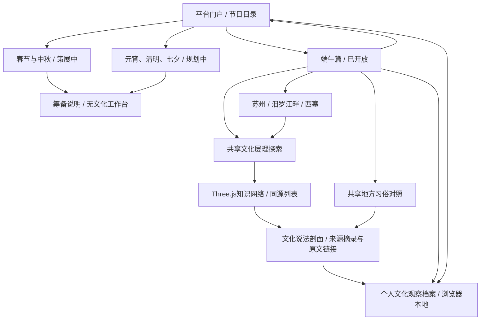
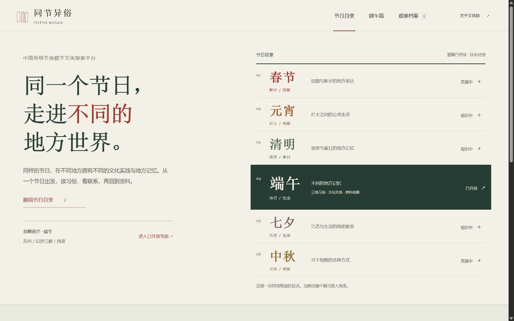
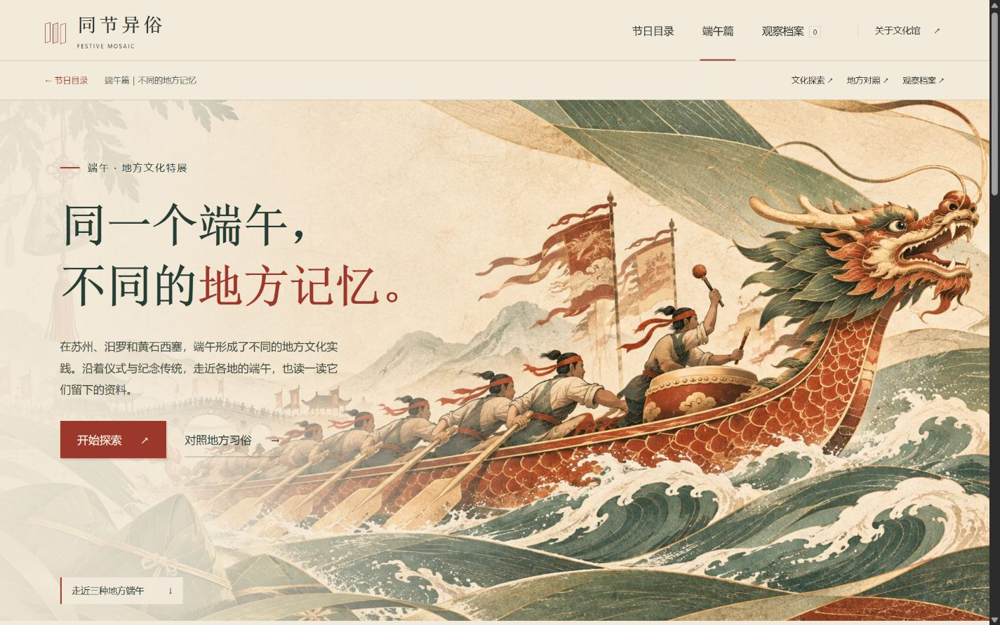

# Festive Mosaic｜多节日平台架构审查

日期：2026-11-17。起始代码：`6957d3de3d2b0bf854ac3734969e2e4af454fd88`。工作目录：`E:\VerifiAtlas`，文化前端：`design/prototype`。目标远程为 [Festive-Mosaic](https://github.com/iuqllTo2048/Festive-Mosaic)，不是原科研远程。

## 产品定位与本轮结果

正式定位：**《同节异俗》（Festive Mosaic）——基于多源文化证据的中国传统节俗智能交互探索系统。** 平台是一座持续扩展的中国传统节俗数字文化馆；端午是首期已开放展厅。

此前根页面直接呈现龙舟、三地端午习俗和端午问题，容易把整个平台理解为端午专题。本轮将它保留为第二层专题，新建第一层节日门户；第三层继续使用已有探索、知识网络、对照、来源和观察档案。没有开发其他节日正文，没有连接或重写RAG。

当前目录：端午为`published`；春节、中秋为`in_preparation`；元宵、清明、七夕为`planned`。后五篇只有策展方向与状态说明，没有地方资料、可用功能或专题工作台。点击目录条目打开筹备说明，不跳入端午，也不呈现虚构节日数据。绕过目录直接访问未开放专题路径，同样被拦截。

## 平台信息架构图

工作台是共享能力，当前只有端午资料接入。智能文化检索是未来能力，没有在配置中标记可用；图中的节点与边来自原有静态文化摘编。

## 路由与组件

采用轻量hash路由，复用Vue现有响应式状态，不安装Vue Router。这样现有静态部署不需要服务器重写规则，刷新深链接仍由同一入口加载。

| 地址 | 实际页面 |
| --- | --- |
| `/`或`/#/` | 新平台门户 |
| `/#/festivals/duanwu` | 原龙舟首页，现为端午篇 |
| `/#/festivals/duanwu/explore` | 端午层理工作台 |
| `/#/festivals/duanwu/compare` | 端午地方对照 |
| `/#/archive` | 平台个人观察档案 |
| `/#/festivals/duanwu/archive` | 档案兼容入口 |
| `/#home` | 原端午首页，保持原义 |
| `/#explore`、`/#compare`、`/#archive` | 原工作台与档案链接 |
| 未开放专题或未知路径 | 明确不可用说明，可返回目录 |

`navigation.ts`集中解析和生成路径。站内导航使用history.pushState，popstate和hashchange同步视图；实际检查前进、后退和刷新。页内目录锚点使用scrollIntoView，不把`#festival-index`、`#local-traditions`和跳转主要内容误当业务路由。

未提供无hash的`/festivals/...`部署重写规则。没有承诺刷新恢复临时问题维度、对照选择、相机或完整探索会话；本地档案恢复是独立能力。

| 文件 | 修改及原因 |
| --- | --- |
| `design/prototype/src/PlatformPortal.vue` | 新门户、六篇编辑式目录、未开放说明、实际交互预览及来源入口 |
| `design/prototype/src/platform.css` | 平台统一外壳、目录视觉、移动布局、专题上下文栏、克制的hover |
| `design/prototype/src/festivals.ts` | 类型化节日配置、发布状态和已实现功能清单 |
| `design/prototype/src/festival-content.ts` | 节日/地方范围适配；为资料、问题、关系和图数据附加归属 |
| `design/prototype/src/navigation.ts` | 新路径、旧链接、功能状态门禁 |
| `design/prototype/src/App.vue` | 连接门户与专题，保留原工作台，统一导航、历史和档案范围信息 |
| `design/prototype/src/HomeExhibition.vue` | 保留原端午美术构图，只调整页内锚点行为 |
| `design/prototype/src/main.js`、`index.html` | 加载平台样式，页面元信息改为平台定位 |
| `design/prototype/src/platform.test.mjs` | 新增配置、发布门禁、路由、资料归属及图范围回归 |
| `design/prototype/package.json`、`tsconfig.json` | 使用Node内置TS类型擦除测试，扩展类型检查到新组件和配置 |
| `design/01_PRODUCT_CONCEPT.md`、`design/02_INTERACTION_AND_VISUAL.md` | 产品与视觉规范同步三层结构 |
| `README.md`、`design/prototype/README.md`、`design/REVIEW_FOR_CHAT.md`、`02_BUILD_PLAYBOOK.md` | 更新当前入口、运行说明、阶段记录与验收索引 |
| `design/screenshots/platform/` | 本轮真实截图与逐项浏览器观察 |

`backend/`、`frontend/`、`eval/`与D6报告不改。原文化`content.mjs`、`content.test.mjs`和`StrataScene.vue`不改；没有迁移数据库、引入依赖或调用DeepSeek。根文档只更新文化项目入口和阶段记录，原科研远程不推送。

## 节日配置与数据归属

`Festival`包含：`festival_id`、`name`、`subtitle`、`description`、`visual_asset`、`status`、`available_features`、`cultural_topics`、`source_references`，另有目录用的`accent`与`index_note`。

端午使用三地topic ID与S01–S04来源目录，开放`explore/graph/compare/sources/archive`。其他五篇的功能、地方主题和来源数组为空，艺术资产为null。目录文字表达策划方向，不作为已经完成的文化研究内容。

发布状态只决定专题能否进入，文化关系仍保持原`located/uncertain`等核验语义。专题published不把关系升级为人工核验或模型支持。

`getFestivalContent`按专题配置过滤现有内容，明确附加`festival_id`和`cultural_topic_id`。来源与问题也携带festival_id；`festivalGraph`仅接受该专题的地方主题，给节点与边附加节日归属，不改变原节点坐标、引用ID及连线判断。未开放专题不能通过传入苏州ID得到端午图。

本地存储键继续为`festive-mosaic-demo-v1`，旧saved ID保持可读。新保存保留原字段，并写入schema_version=2及带festival_id、cultural_topic_id、claim_id的saved_refs。当前仍读取兼容旧版的saved字段；未来多节日档案需要将saved_refs作为主要身份，并明确处理跨专题ID碰撞。本轮没有把它宣称为完整多节日档案迁移。

未来新增专题应接入其真实资料适配器、专属视觉和发布验收，复用工作台；不能只把status改为published。目前App工作台仍明确绑定端午，专题艺术组件仍是端午实现，没有假设六篇可以仅靠配置自动生成内容。

## 视觉取舍与素材需求

统一语言延续当代东方版画、数字文化展览、编辑式网页。平台使用米白纸色、炭墨、朱砂、青绿，统一品牌、宋体标题、正文、按钮、焦点、档案与导航。节日用独立色调、主题词和未来专属构图表达身份。

门户没有把龙舟作为唯一文化主体，也没有采用六张相同卡片。左侧主张与右侧展签式索引组成首屏；已开放端午用深青绿大展签突出，其余条目保持可读目录。下半屏的知识网络预览来自现有界面截图，搭配实际可进入的对照与来源，没有虚构运行数据。手机将主张、快捷入口、目录顺次排列，目录锚点能直接滚到专题索引。

原龙舟首页保留三屏内容和两张WebP：

- `design/prototype/public/images/hero_dragon_boat.webp`：端午核心主视觉，1672×941。
- `design/prototype/public/images/cultural_collage.webp`：端午地方文化区局部，1672×941。
- 门户另复用已有`public/previews/cultural-strata.jpg`，仅作为真实界面预览。

本轮没有新增或重新绘制美术、下载图片、使用地图或简陋SVG替代艺术作品。门户正式的多节日艺术主视觉仍是**待补充设计资产**；目前交付的是完整编辑式门户，页面没有工程占位图。

| 待补素材 | 用途与建议交付 |
| --- | --- |
| 平台多节日主视觉1套 | 同一版画语言连接多个节日的材料与生活意象；独立于龙舟。建议桌面横幅至少2400×1400，另出手机4:5构图，保留标题阅读区 |
| 六节日目录局部图形1套 | 每篇独立识别、统一线面与纸本质感，建议每枚800×800以上或保留可编辑母版；当前类型目录可继续使用，不强制替换为图标 |
| 苏州、汨罗、西塞插画各1张 | 用于端午地方目录替换现有拼贴局部；建议统一4:3母版和手机裁切参考，围绕已选资料对象策划 |
| 春节/中秋及其余专题专属主视觉 | 仅在专题资料和地方主题确定后开展，各自准备横向和手机独立构图；本轮不生成、不发布 |

两张源WebP保持不变；用户源素材文件夹及ZIP不进入本轮提交。

## 实际验收

环境：Windows PowerShell，Node22.23.2，Vue3、TypeScript、Vite8.3.8、Three.js；沿用`frontend/node_modules`。本轮开发服务`http://127.0.0.1:5175/`返回HTTP200，使用实际in-app Chromium浏览器，非仅静态DOM模拟。

| 必须流程 | 实际操作与结果 |
| --- | --- |
| 平台→专题→平台 | 点击目录端午，地址为`#/festivals/duanwu`；显示原龙舟页；点击返回目录，恢复门户 |
| 专题→探索→关系→专题 | 主操作进入实践维度；Three.js生成1个Canvas，12节点/11连线；切列表得到4条摘编关系，苏州龙舟关系打开S01摘录与原文链接；导航返回专题 |
| 地方对照 | 苏州/汨罗共同竞渡1项；可分别打开S01、S02原文链接；B改为西塞，显示独立记录和未定位共同细项提示，8节点/6连线 |
| 未开放专题 | 五个目录入口逐个点击，都仅显示各自状态说明；手机另检查七夕；直接访问中秋explore显示尚未开放，Canvas为0 |
| 档案保留 | 保存sz-race，进入档案并刷新，关系与来源仍在；未清空本地存储 |
| 旧链接与历史 | 四个旧hash直达对应页面；实际前进后退在门户与档案间同步 |
| 页内链接 | 手机门户滚到目录、端午滚到地方主题，业务hash保持不变；苏州主题进入2条实践关系列表 |
| 改造后图谱 | 范围适配层加入后重新进入三维，Canvas正常，12节点/11连线；复位可操作 |

S01原文链接仍为`https://szfy.wglj.suzhou.com.cn/fy-project/16`；S02仍为`https://www.ihchina.cn/project_details/14916.html`。本轮检查抽屉引句与链接匹配，没有重新开展文化史实或语义独立人工复核。

| CSS视口 | 门户 | 端午专题 | 横向溢出 |
| --- | --- | --- | --- |
| 1440×900 | 左主张/右目录，首屏完整识别六篇状态 | 大龙舟与标题、操作、专题返回栏 | 两页均无 |
| 1024×768 | 保留双栏，压缩字体与间距 | 保留主体与操作 | 两页均无 |
| 390×844 | 独立单列、目录跳转、已开放展签 | 标题操作在上、艺术裁切在下 | 两页均无 |

逐张查看实际截图：门户的焦点为主标题与端午开放展签，专题的焦点为龙首与标题；品牌一致，页面职责不同。手机端午双操作底部约在CSS y=551，首屏可操作。目录与说明文字没有被横向裁掉。此项为Codex基于真实截图的视觉复核，用户艺术审核和独立真人可用性测试仍待进行。

截图文件尺寸受浏览器工具输出缩放影响，不等同于CSS视口；例如1440视口导出1425×891、1024导出1009×757、390导出375×812。验收尺寸以实际innerWidth/innerHeight记录为准。调整视口后曾出现一次旧合成表面的缩小截图，已在布局稳定后重新捕获并替换，没有将它作为交付图。

本轮截图：

| 平台门户 | 端午专题 |
| --- | --- |
|  |  |
| [1024门户](../design/screenshots/platform/portal-1024.jpg) | [1024端午](../design/screenshots/platform/duanwu-1024.jpg) |
| [390门户](../design/screenshots/platform/portal-390.jpg) · [手机目录](../design/screenshots/platform/portal-390-index.jpg) | [390端午](../design/screenshots/platform/duanwu-390.jpg) |

另有[门户交互案例区](../design/screenshots/platform/portal-method-1440.jpg)、[未开放说明](../design/screenshots/platform/unopened-topic.jpg)、[探索](../design/screenshots/platform/explore-1440.jpg)、[对照](../design/screenshots/platform/compare-1440.jpg)、[来源](../design/screenshots/platform/source-trace.jpg)。逐项原始观察见[browser-checks.json](../design/screenshots/platform/browser-checks.json)，它是浏览器实操记录，不混计为单元测试数量。

## 工程验证结果

在`E:\VerifiAtlas\design\prototype`实际执行：

| 命令 | 真实结果 |
| --- | --- |
| `npm.cmd test` | 8通过、0失败、0跳过：原4项内容测试+新增4项架构回归 |
| `npm.cmd run typecheck` | 通过，覆盖两个首页TS组件及新增TS配置/作用域/导航；旧JS工作台未做全量严格类型迁移 |
| `npm.cmd run build` | 成功，26模块；CSS48.75kB、主JS119.64kB、Three.js延迟块572.55kB |
| 实际浏览器error/warn日志 | 0条，逐项记录随截图提交 |

Three.js分块仍有大于500kB的既有构建告警，未调高阈值掩盖。测试使用Node内置类型擦除而非新依赖，当前测试命令要求Node22.18+。生产构建产物位于`E:\VerifiAtlas\design\prototype\dist`，Git忽略。

验证工具有一次不支持的heading level过滤导致定位多元素；改为读取明确的h1后完成旧链接检查。这是验收脚本选择器问题，不是站点导航失败；没有修改业务逻辑来取得通过。

没有重跑未改动科研前后端的测试，没有运行在线模型或检索实验。Git提交前检查差异、敏感信息、保护目录及diff --check；密钥、PDF、数据库与源素材包不加入提交。

## 当前限制与后续停止点

1. 仅端午有真实文化内容。其他节日是目录策划，不是已实现专题；没有为它们创建页面副本。
2. 通用工作台复用当前端午实现。正式扩展需要真实资料适配、专题艺术组件和档案身份迁移，不能仅修改配置状态。
3. AI文化资料检索、文化RAG、账号、云同步和正式导出尚未实现。平台没有虚构实时运行。
4. 正式多节日主视觉及三地专属插画待补。当前门户用编辑式策展完成布局，未来艺术方案仍需用户审核。
5. 手机是浏览器视口检查，未做实体手机触控、读屏、200%系统缩放、慢网或多GPU全面测试。已有WebGL降级保留，本轮未做故障注入。
6. 本轮检查来源联动与引用身份，没有把来源定位视为文化事实认证，也没有新增人工核验标签。

**本阶段到此停止：统一一次Git提交并推送文化项目远程，等待用户审核。没有继续开发春节、中秋或其他专题。**
